<div align="center">

# Science of AI Prototype

**给定模糊问题，agent 自选小问题、预注册、做受控实验，把测量、反例和下一问写进知识库（KB）。**

[交接说明](docs/HANDOFF.md) · [研究方向](docs/RESEARCH_DIRECTIONS.md) · [操作手册](docs/OPERATIONS.md) · [模糊方向网页](https://guoshaoyang-pku.github.io/science-of-ai-prototype/模糊方向/) · [science-of-ai-kb](https://github.com/guoshaoyang-pku/science-of-ai-kb)

</div>

> 本库包含支持解题与异步研究的 KB runtime，以及 13 个模糊方向的研究快照。默认保持 parked，不启动研究轮。

---

## 目录

- [图示索引](#图示索引)
- [SAI 框架与综述](#sai-框架与综述)
- [安装与检查](#安装与检查)
- [代码和证据](#代码和证据)
- [当前结果](#当前结果)

---

## 图示索引

所有图都在 `sai-taxonomy` 分支内，点图即可看原文件。

### 框架

<table>
<tr>
<td align="center" width="50%"><a href="sai-paper/illustrated/fig09_levels.svg">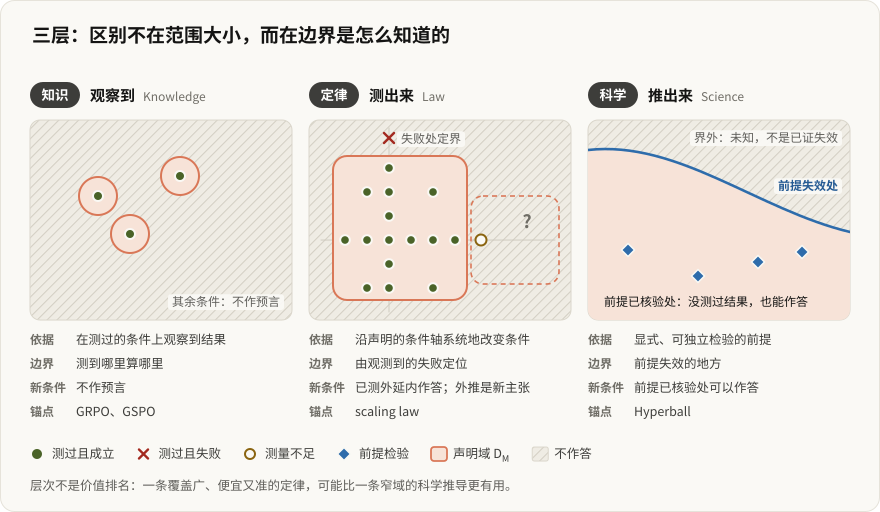</a><br><sub>三层：知识、定律、科学</sub></td>
<td align="center" width="50%"><a href="sai-paper/illustrated/fig02_overview.svg">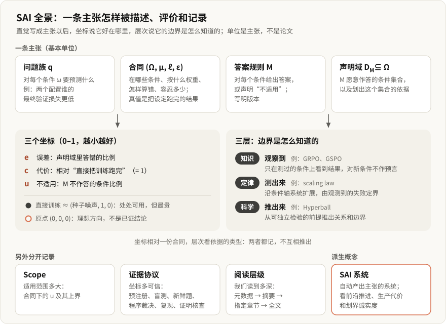</a><br><sub>框架总览</sub></td>
</tr>
<tr>
<td align="center"><a href="sai-paper/illustrated/fig11_science.svg">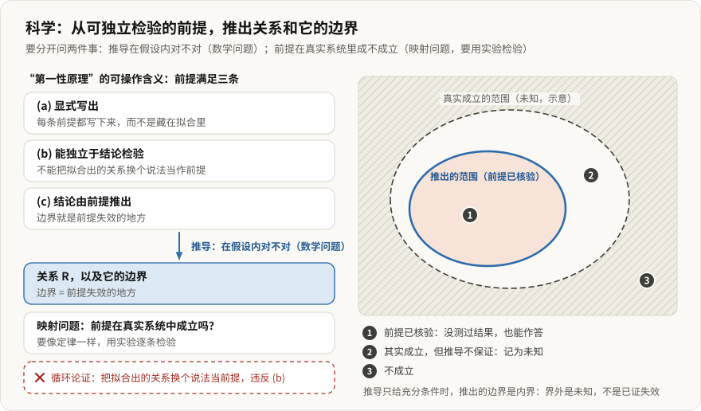</a><br><sub>Science 层的来源</sub></td>
<td align="center"><a href="sai-paper/illustrated/fig15_vision.svg">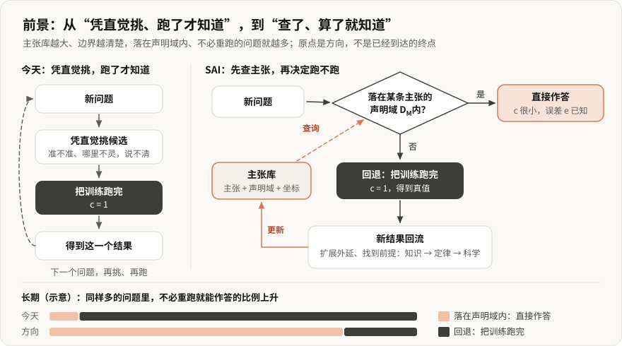</a><br><sub>愿景</sub></td>
</tr>
</table>

<details>
<summary>全部 15 张框架图（fig01 到 fig15）</summary>

| | | |
|:-:|:-:|:-:|
| [fig01 核心](sai-paper/illustrated/fig01_core.svg) | [fig03 主张](sai-paper/illustrated/fig03_claim.svg) | [fig04 坐标](sai-paper/illustrated/fig04_coords.svg) |
| [fig05 轴](sai-paper/illustrated/fig05_axes.svg) | [fig06 回退](sai-paper/illustrated/fig06_fallback.svg) | [fig07 ρ*](sai-paper/illustrated/fig07_rho.svg) |
| [fig08 上界](sai-paper/illustrated/fig08_upper_bound.svg) | [fig10 定律轴](sai-paper/illustrated/fig10_law_axes.svg) | [fig12 升级](sai-paper/illustrated/fig12_promote.svg) |
| [fig13 记录](sai-paper/illustrated/fig13_records.svg) | [fig14 系统](sai-paper/illustrated/fig14_system.svg) | |

</details>

### 报告用图

<table>
<tr>
<td align="center" width="50%"><a href="sai-paper/report/figs/diagram_ladder.svg">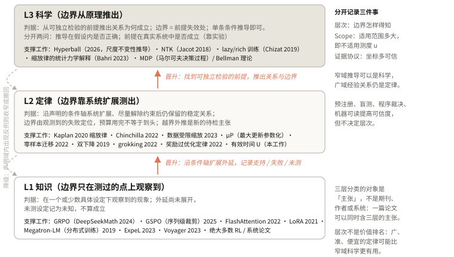</a><br><sub>层次阶梯</sub></td>
<td align="center" width="50%"><a href="sai-paper/report/figs/diagram_loop.svg">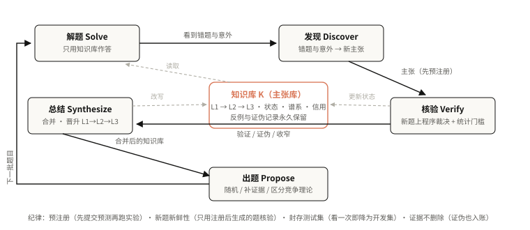</a><br><sub>研究循环</sub></td>
</tr>
<tr>
<td align="center"><a href="sai-paper/report/figs/kb_lift.svg">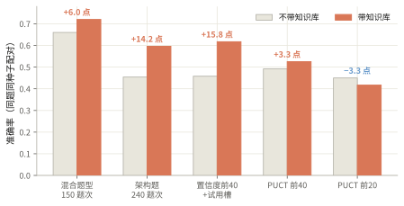</a><br><sub>知识库提升</sub></td>
<td align="center"><a href="sai-paper/report/figs/equiv_compute.svg">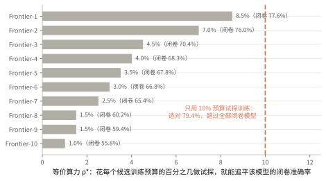</a><br><sub>等效算力</sub></td>
</tr>
</table>

### 实验：D2 过拟合与 D4 训练曲线

<table>
<tr>
<td align="center" width="50%"><a href="science_program_v2/directions/D2_overfitting_u_curve/figs/rising_branch_collapse.png">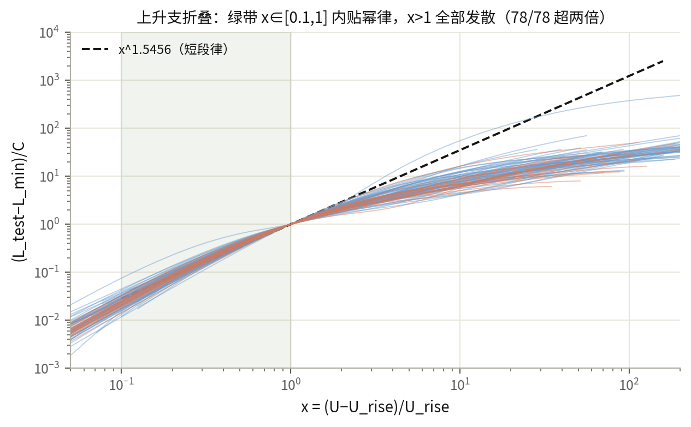</a><br><sub>D2：上升支的坍缩</sub></td>
<td align="center" width="50%"><a href="science_program_v2/reports/figs/scaling_law.png">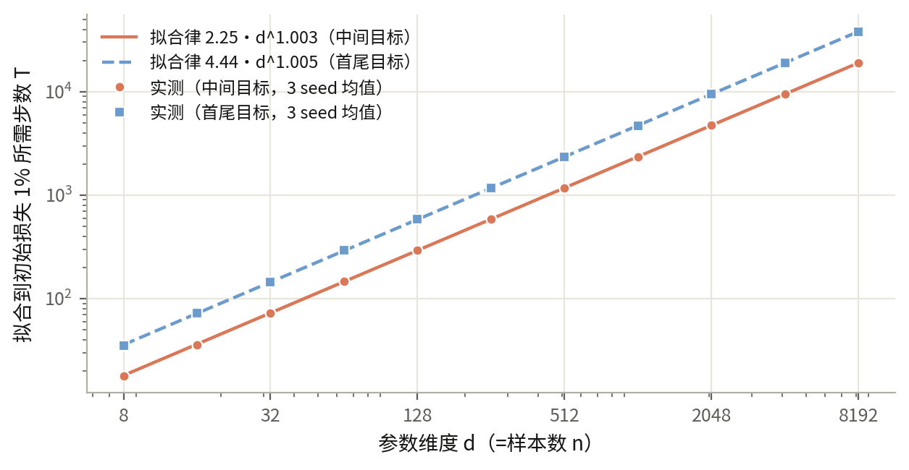</a><br><sub>scaling law 汇总</sub></td>
</tr>
<tr>
<td align="center"><a href="science_program_v2/directions/D4_sigmoid_training_curve/figs/decision_map.png">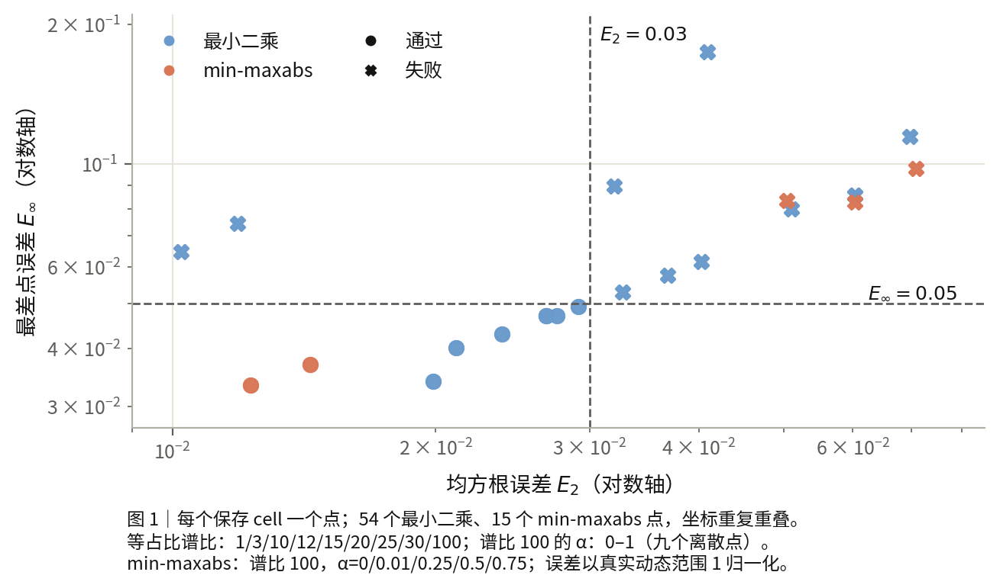</a><br><sub>D4：决策图</sub></td>
<td align="center"><a href="science_program_v2/directions/D4_sigmoid_training_curve/figs/pointwise_errors.png">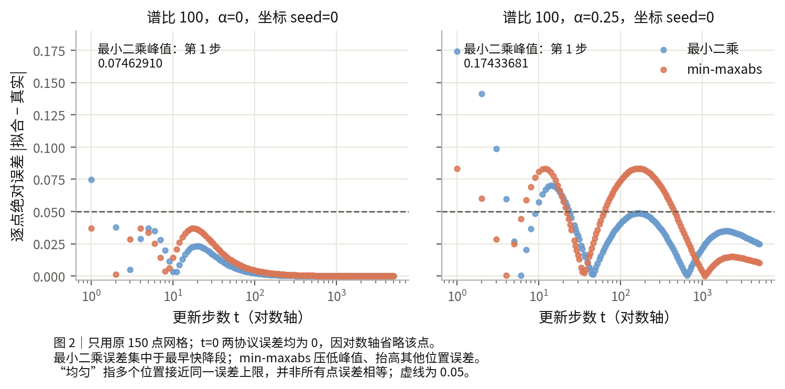</a><br><sub>D4：逐点误差</sub></td>
</tr>
<tr>
<td align="center"><a href="evidence/d2_scaling_20261009/figs/cross_task_laws.png">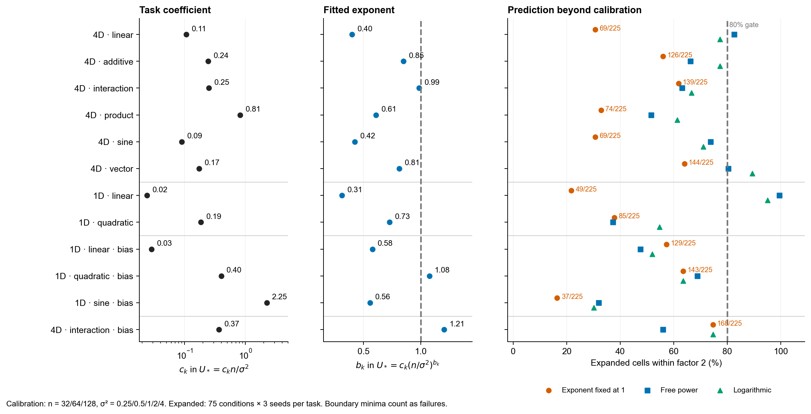</a><br><sub>D2 扩域：跨任务定律</sub></td>
<td align="center"><a href="science_program_v2/directions/D2_overfitting_u_curve/figs/r113_population_coefficient.png">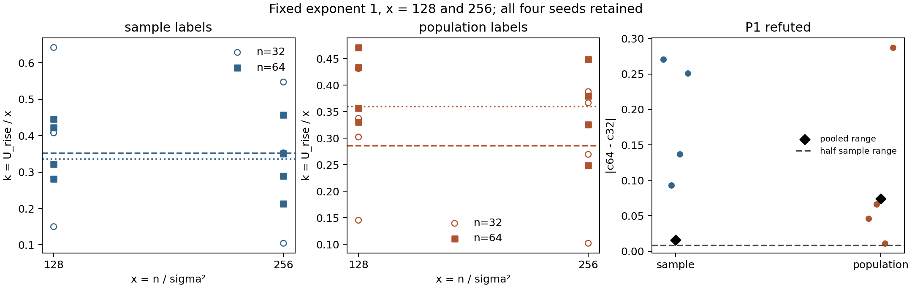</a><br><sub>D2：总体系数</sub></td>
</tr>
</table>

### 预注册研究（v1）

<table>
<tr>
<td align="center" width="50%"><a href="references/science_program_v1/studies/A03_ln_width/ln_width.png">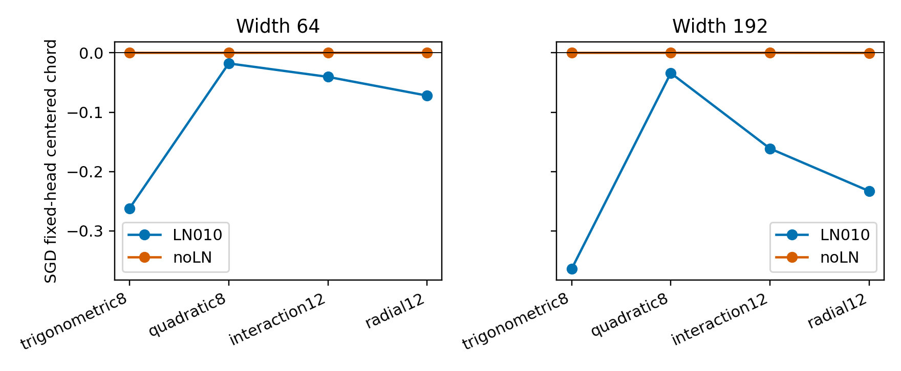</a><br><sub>A03：LN 与宽度</sub></td>
<td align="center" width="50%"><a href="references/science_program_v1/studies/B02_nonlinear_clock/development_curves.png">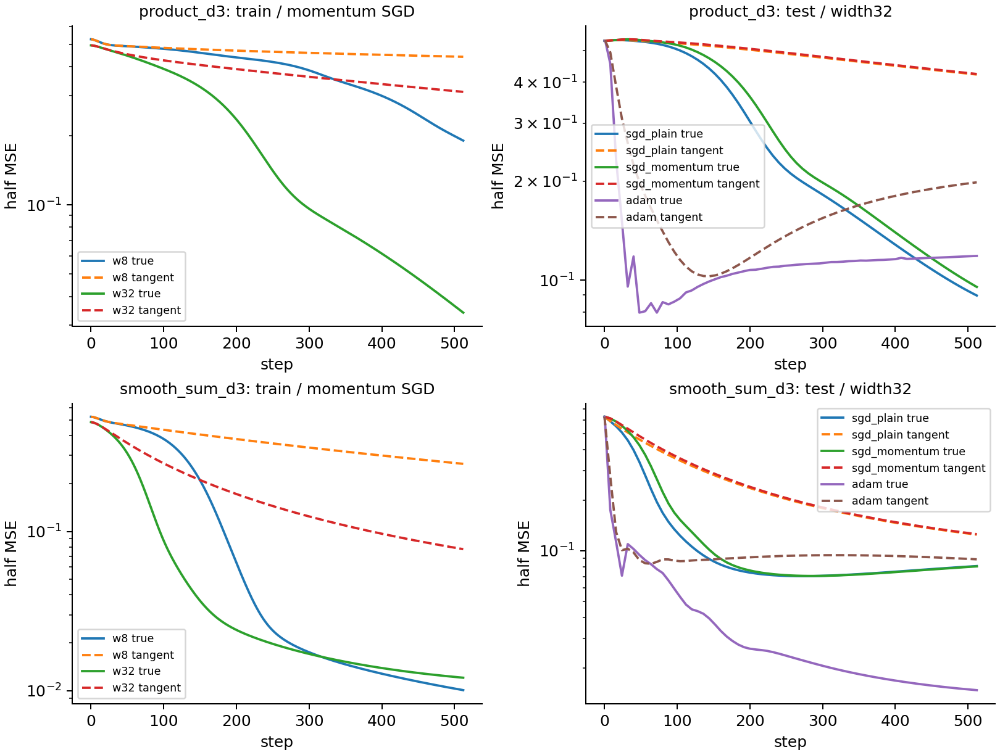</a><br><sub>B02：非线性时钟</sub></td>
</tr>
<tr>
<td align="center"><a href="references/science_program_v1/studies/C04_noise_generalization/noise_u_curve.png">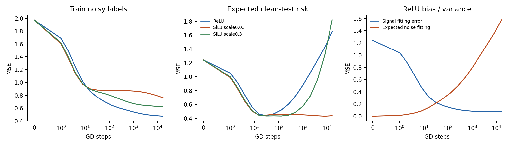</a><br><sub>C04：噪声 U 型曲线</sub></td>
<td align="center"><a href="references/science_program_v1/studies/C05_risk_ood/risk_ood_forecast.png">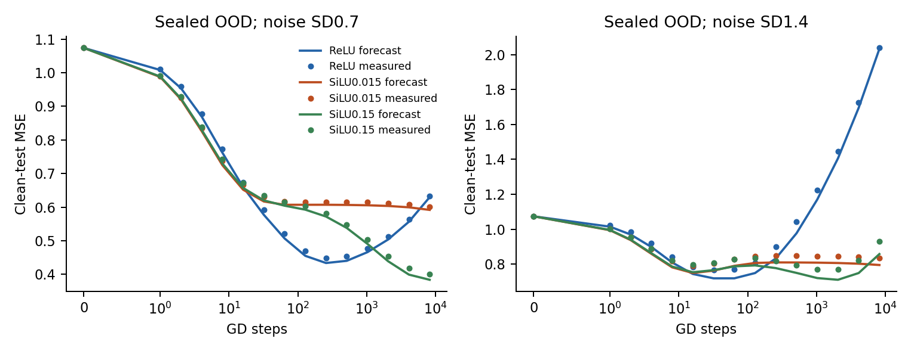</a><br><sub>C05：OOD 风险预测</sub></td>
</tr>
</table>

### 研究循环

<table>
<tr>
<td align="center" width="50%"><a href="figures/loop-1.png">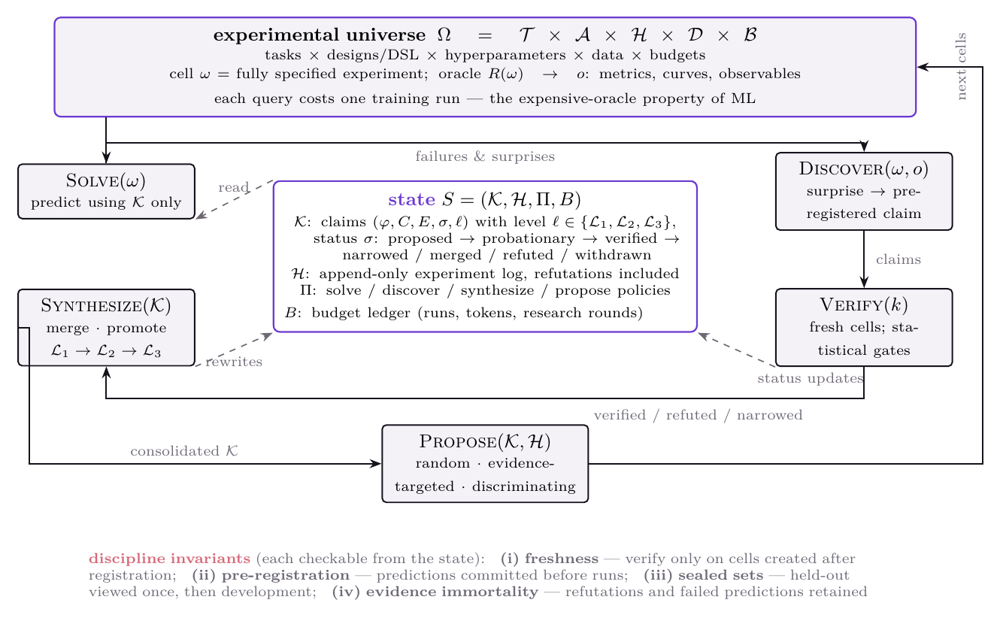</a><br><sub>循环</sub></td>
<td align="center" width="50%"><a href="figures/ladder-1.png">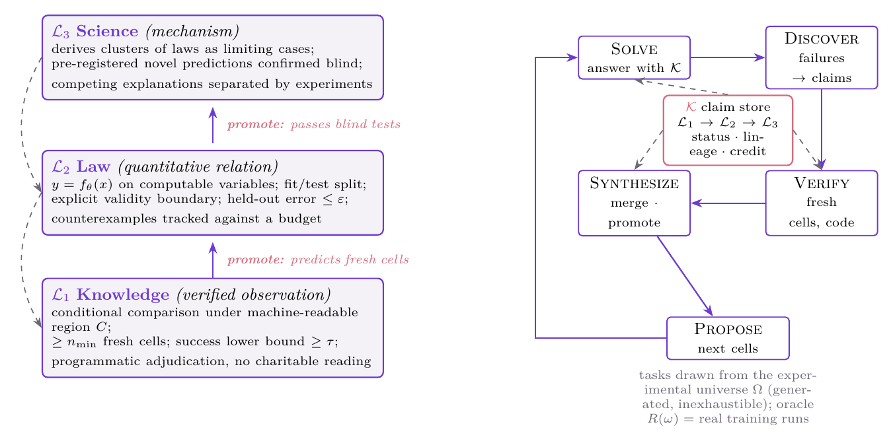</a><br><sub>阶梯</sub></td>
</tr>
<tr>
<td align="center"><a href="figures/positioning-1.png">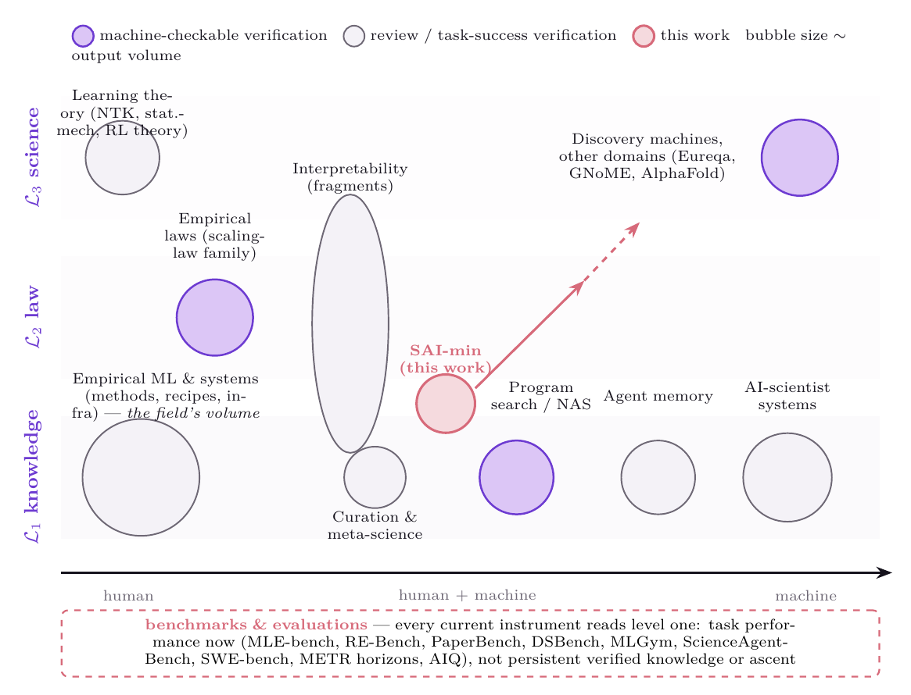</a><br><sub>定位</sub></td>
<td align="center"><a href="figures/results-1.png">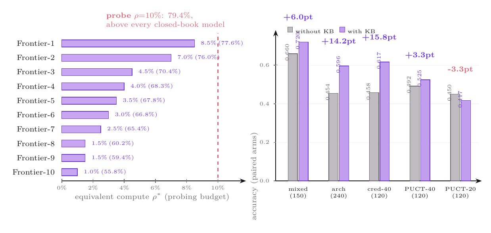</a><br><sub>结果</sub></td>
</tr>
</table>

---

## SAI 框架与综述

本仓库的实验是一个更大框架的具体实例。英文入口如下：

- **[taxonomy/](taxonomy/)**：SAI 分类法。把 ML 研究分成三个认知层次（知识、定律、科学），给出五步研究循环、度量（等效算力、压缩比、SAI Index）、里程碑 M0 到 M6，以及十个研究家族。
- **[survey/](survey/)**：配套文献综述，932 篇论文、872 个概念，覆盖 RL、预训练和可解释性，每条都标了层次与适用边界。
- **[sai-paper/](sai-paper/)**：综述背后的语料，包括原始分类记录（`literature/`）、覆盖与边界文档、目录构建脚本、反例脚本，以及合并交接材料（`handoffs/`）。这里只放公开层，全文 PDF、内部笔记和冻结稿件留在本地。

---

## 安装与检查

Python 3.10+，macOS 或 Linux；Windows 使用 WSL。

```bash
git clone --recurse-submodules https://github.com/guoshaoyang-pku/science-of-ai-prototype.git
cd science-of-ai-prototype
./setup.sh
.venv/bin/python tools/verify_handoff.py
.venv/bin/python -m pytest -q
```

安装与检查不需要模型密钥。完整曲线需下载 [handoff-20261009 Release](https://github.com/guoshaoyang-pku/science-of-ai-prototype/releases/tag/handoff-20261009)：

```bash
gh release download handoff-20261009 --repo guoshaoyang-pku/science-of-ai-prototype --pattern '*.part*' --pattern SHA256SUMS --dir ../science-evidence
.venv/bin/python tools/fetch_evidence.py --archives ../science-evidence --verify-only
```

去掉 `--verify-only` 会把已校验的归档解压到本 checkout 对应的证据目录。测量结果已被 gitignore 排除。

---

## 代码和证据

| 入口 | 内容 |
|---|---|
| `src/aiq_kb/`、`tests/` | loop、持久 jobs、agent 适配、lab、viewer、publisher 与回归测试 |
| `science_program_v2/` | supervisor、128 条旧 claim、13 个方向的 task、report、findings，以及预注册与 summary |
| `research/d2_scaling_20261009/` | 最新 D2 扩域与跨任务实验的验证、绘图和发布代码 |
| `evidence/d2_scaling_20261009/` | 最新 D2 报告、数字、图和执行审计，优先于旧 D2 报告 |
| `references/science_program_v1/` | v2 引用的 v1 代码、报告与轻量证据 |
| `evidence/manifests/`、`evidence/history/` | 每个文件的 source 与 export hash、归档 hash、历史 commit 索引 |
| `docs/模糊方向/` | 可共同编辑的研究网页、图片和证据附件，GitHub Pages 发布源 |
| `external/ArchitectureIQ/` | 来自 AIQ main、固定 commit 的 submodule，题目与 benchmark runtime 的外部来源 |
| `benchmark_compat/` | 旧 KB lab 的 process 与 target-transform 补丁，可应用到外部副本 |

题库来源是 [renrua52/ArchitectureIQ](https://github.com/renrua52/ArchitectureIQ) 的 main，固定在 `6eafe8c1e11c5dc6ad28254caf2669be2ee4da8c`。新实验还需明确 release、暴露记录和 group、seed、variant 的隔离。换 seed 不会产生新题。题库正文与最终 benchmark test 没有复制进本库。

保存数据约 3.3 GB，按 v1、v2、D2 三个归档提供，共 100 个 Release 分片。工具会校验分片、重组，再校验归档总 hash。数值数组保持原字节，机器路径在文本和元数据中归一化，原 hash 与交付 hash 都记录在清单里。完整模型会话、CLI home、凭据和旧 Git 对象不入库。原时序以 commit 索引交接，索引本身不作为独立的时序证明。

---

## 当前结果

D2 新扫描有 3,240 条固定特征的回归轨迹。12 个任务与特征条件都不支持"扩域后只换系数"的统一指数 1 定律。回升不要求 train 先接近零。

这是受控模型上的边界结果，不确立通用训练理论，也不确立新的 solver 收益。[最新报告](evidence/d2_scaling_20261009/report.md) 保留了失败分母、曲线和机制示意图。

---

<div align="center">

MIT 许可，保留 ArchitectureIQ Authors（MetaCircle）署名。早期公开版本仍在 [science-of-ai-kb](https://github.com/guoshaoyang-pku/science-of-ai-kb)。

</div>
