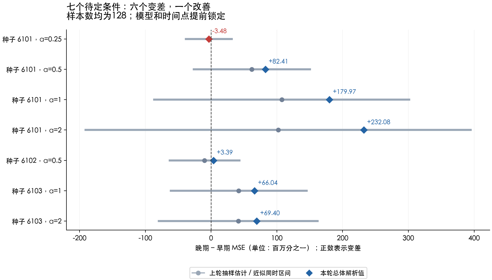

# D2 第三轮：哪些回升是真的，哪些只是验证集的错觉？

## 先看结论

**在这批固定模型、固定时间点上，50个条件的总体误差上升，1个略微下降，另3个窗口边界仍不评价。** 上一轮的44个明确回升全部保留；7个待定条件现在分清为6升、1降。没有把反例删掉，也没有重新寻找更有利的时间点。

这进一步确认：没有标签噪声，也可能出现“训练误差下降、新题平均误差上升”。但旧验证集上观察到回升，不保证总体也回升。**本轮确认了现象和一个反例，尚未确定导致现象的具体机制。** 范围仍是已看过的固定ReLU特征回归条件，不是大模型或新任务上的结论。

## 这次为什么能算得更清楚

上一轮让两个已保存模型回答13万道随机新题，用答题差估计总体表现。题再多仍有抽样波动，所以有7个小变化无法分清正负。

这次利用实验本身的特殊条件：我们知道输入服从标准高斯分布，也知道生成正确答案的公式。因此可以直接积分，计算模型在这个分布上的平均MSE，而不再抽一批题来估计。**已知分布、已知目标、固定特征，才让这一步可行；不是任意真实任务都能这样预测。** 解析表达式精确，计算机数值仍有有限精度，所以另做了60位精度核对。

| 符号 | 人话解释 |
|---|---|
| β | 已保存模型的输出层权重 |
| φ(x) | 同一套固定特征，包括常数项 |
| Q=E[φφᵀ] | 各特征在总体上怎样共同变化 |
| h=E[φy] | 各特征与正确答案的联系 |
| R(β)=βᵀQβ−2βᵀh+1 | 把MSE展开后，对输入总体取平均；目标均方值为1 |

高斯ReLU的二阶矩使用已有arc-cosine公式，注意原论文的kernel是本轮ReLU乘积期望的两倍。[Cho与Saul，2009，公式(1)、(3)、(6)](https://proceedings.neurips.cc/paper_files/paper/2009/file/5751ec3e9a4feab575962e78e006250d-Paper.pdf)。目标相关矩由条件高斯积分推导，完整推导和适用前提见仓库formulation.md。这些数学恒等式不是本轮新发现。

## 成立到什么程度

| 检查对象 | 上一轮状态 | 本轮总体计算 |
|---|---|---|
| 44个明确回升 | 新验证样本支持上升 | 44个全部仍超过预注册门槛 |
| 7个待定 | 区间跨过0，无法确定 | 6个上升、1个下降 |
| 3个窗口边界 | 不评价窗口外 | 继续保留，不计入51 |
| 合计 | 44确认、7待定、3边界 | 50上升、1下降、3边界 |

主预测是“原44个全部保留”，不是事后改成50/51。结果支持这个预注册预测。51个条件都落在上一轮各自的近似同时区间内；这是相容性核对，不是这些区间严格覆盖率的证明，也不能把51个相关条件当成51次独立训练。

## 一个变差的例子，一个明确反例

| 条件 | 冻结时间 | 总体MSE：早 → 晚 | 训练MSE变化 | 怎么理解 |
|---|---|---|---:|---|
| n=32，seed=6103，α=2 | 547 → 1094 | 0.130839 → 0.139521 | -0.004343 | 训练题更好，新题平均更差 |
| n=128，seed=6101，α=0.25 | 5298 → 10596 | 0.00899348 → 0.00899000 | -0.000284 | 训练和总体表现都略有改善 |

反例中，总体误差下降约0.00000348。变化很小，但高精度核对误差远小于它，因此不能把它说成“其实也回升”。它只否定这两个时间点之间的回升，不证明此条件以后永不回升，也不证明整个区间单调下降。

## 方法：只换评价方式，不改模型

- 使用第二轮锁定的51对权重和原时间；没有重新训练、重新选停止点或新增条件。
- 训练中心和尺度保持原值；总体均值与训练均值不同，常数项及其交叉项都保留。
- 前后风险差用等价的稳定表达式计算，减少相近数字相减造成的误差；没有裁负结果或修改矩阵让结果“好看”。
- 判定门槛仍为旧初始MSE的百万分之一，另加10⁻¹⁰量级的数值容差。这个小门槛用于辨认变化，不代表应用上重要。
- 每组矩由独立一维积分校验；所有51对风险另用原始特征坐标及60位精度重算。

## 七个待定条件现在各是什么结果

下表和图的单位都是“百万分之一MSE”。正数表示变差，负数表示改善；全部条件的n=128。

| 种子 | α | 时间 | 上轮估计 | 总体解析值 | 判断 |
|---|---:|---:|---:|---:|---|
| 6101 | 0.25 | 5298→10596 | -3.65 | -3.48 | 改善 |
| 6101 | 0.5 | 3293→6586 | +61.99 | +82.41 | 变差 |
| 6101 | 1 | 2513→5026 | +107.42 | +179.97 | 变差 |
| 6101 | 2 | 2185→4370 | +102.01 | +232.08 | 变差 |
| 6102 | 0.5 | 785→1570 | -9.96 | +3.39 | 变差 |
| 6103 | 1 | 503→1006 | +42.02 | +66.04 | 变差 |
| 6103 | 2 | 399→798 | +41.33 | +69.40 | 变差 |

例如seed6102、α=0.5，上轮点估计略微下降，但区间跨0，本来就不能下结论；总体计算现在显示小幅上升。保留“待定”而不强行给正负结论是有必要的。

## 还没回答什么，下一步怎样改实验

我们尚未分清两种解释：一是固定特征表达不了完整目标；二是有限训练样本让训练方向偏离总体需要的方向。这两者可能共同作用。

下一轮候选：先把原目标投影到同一套固定特征能够表达的函数空间，得到一个“模型确实能表示”的目标，然后在相同训练输入、初始化、学习率和冻结时间下比较。若它仍回升，就说明“表达不了目标”不是必要条件；若回升明显消失，说明被移除部分对这批条件的变化有贡献，但仍不能说找到了普遍唯一原因。

这个投影需要总体信息，是机制诊断对照，不是可部署的train-only方法。下一轮尚未预注册或执行，本轮没有顺手做该干预。所有已看过条件继续标记为development。

## 证据与边界

- 预注册commit：`ab8fa105d4cc648f44f92179351a83268b5f9bd5`，早于执行；单线程CPU计算约2.35秒。没有付费API、GPU、solver或自动发布网站。
- rows.json：全部54条，包括1个下降、3个边界，以及51条高精度风险/差值字符串；summary.json：主预测和全部分母。
- moments/：9组总体矩和对应固定特征参数；verification.json：90个特征对积分、2304个目标交叉矩积分、51对原始坐标和高精度核对。目标矩积分含重复权重的不同训练尺度条件，不算2304个独立实验。
- float64与60位结果最大差6e-15，原始坐标展开最大差8.2e-15。这只验证数值计算，不保证真实世界满足输入/目标假设。
- formulation.md与run.py在本仓库research/d2_continuous_20261103/r003_population_risk；初始产物由manifest.json固定，后补报告和独立审计由仓库result_manifest.json固定。
- 交接脚本仍在当前worktree的ArchitectureIQ子模块commit检查处失败（未初始化子模块）；未操作该子模块。本轮D2输入另以9份原始文件hash校验，测试与交接状态记于result_manifest.json。

独立审计通过：统计、来源与独立矩计算的核对记录见independent_audit.json。
