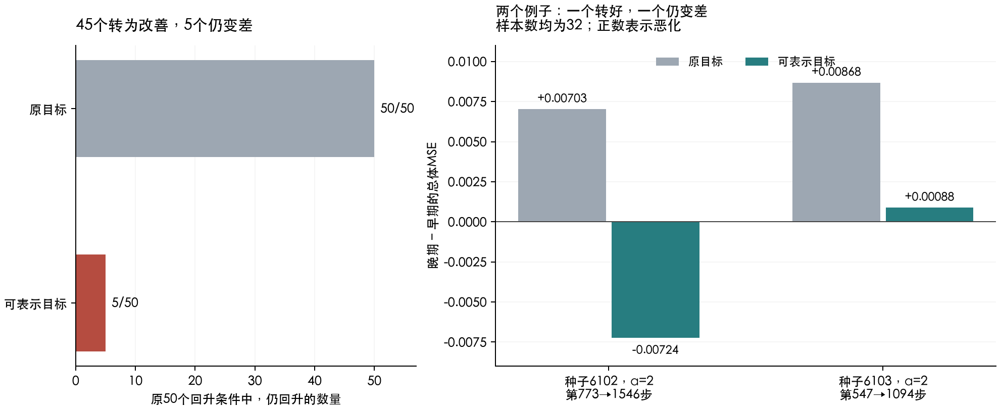

# D2 第四轮：如果模型能表达正确答案，还会越学越差吗？

## 结论：大多数回升消失，但留下了5个反例

前三轮已经确认：没有标签噪声，训练误差下降时，总体误差也可能上升。这一轮进一步把正确答案换成同一模型**确实能够表示**的版本，其他训练条件和两个评价时刻保持原值。

**原来50个总体误差回升的条件中，45个转为改善，5个仍然变差，而且训练误差继续下降。** 这说明：移除目标中不能表示的部分，对这批条件的表现有很大影响；但“表达不了目标”并不是回升必不可少的条件。我们找到了5个反例，没有因此确定唯一原因或普遍规律。

这里是50个已有开发条件，来自9个训练/特征抽样、3个主种子，不是50种独立任务。另一个原本改善的条件仍改善，3个窗口边界仍不评价；完整总账始终是54个。

## 这次具体改了什么

可以把固定特征想成模型手里的一套积木。原来的答案可能需要它没有的形状。这次先找出：用现有积木能拼出的、总体上最接近原答案的版本。再把训练标签改成这个版本。

这一步叫“总体投影”。它保证存在一组输出权重能完全表示新目标，但不保证模型靠有限训练样本就能找到这组权重。

| 项目 | 本轮设置 |
|---|---|
| 改变 | 训练标签：原目标y → 可表示目标g |
| 固定 | 输入样本、固定特征、零初始化、学习率0.3、全批量MSE、旧的两个时间点 |
| 标签噪声 | 始终为0 |
| 新停止点 | 没有重新搜索 |
| 主比较范围 | 第三轮确认回升的50个条件 |
| 判据 | 至少找到1个充分核验的例子：训练MSE下降，同时总体MSE上升超过预设小门槛 |

投影没有重新放大或缩小。我们另外保存了目标的均方大小，避免把幅度变化隐藏起来。这是借助已知总体信息做的诊断实验，不是现实任务中只看训练数据就能直接使用的方法。

## 结果成立到什么程度

| 观察 | 数量 | 解释 |
|---|---:|---|
| 回升转为改善 | 45/50 | 在原来冻结的两个时刻，新目标下继续训练有益 |
| 仍回升，训练误差仍下降 | 5/50 | 可表示性和无标签噪声都不能保证总体误差一直下降 |
| 回升幅度比原来更大 | 3/50 | 三个都在上述5个之内，不能再加到总数上 |
| 原本改善的辅助条件 | 1/1仍改善 | 未拿来补主预测的成功数 |
| 窗口边界 | 3/54 | 保留，不评价窗口外 |

预注册只预测“至少存在1个”，结果找到5个，支持这一存在性预测。45个转好不等于“90%的泛化恶化已被解释”；两个目标的训练轨迹发生了变化，这里没有计算因果贡献比例。

## 同一个时间区间，两个具体例子

| 条件 | 时间 | 原目标的总体MSE变化 | 换目标后的变化 | 换目标后的训练MSE变化 |
|---|---|---:|---:|---:|
| n=32，seed=6102，α=2 | 773→1546 | +0.00703 | -0.00724 | -0.000592 |
| n=32，seed=6103，α=2 | 547→1094 | +0.00868 | +0.00088 | -0.000198 |

第一例由变差转成明显改善。第二例回升小了很多，但没有消失：总体MSE仍从0.02907升到0.02995，训练MSE却从0.000369降到0.000170。

## 为什么这不只是换了评分标准

g是原目标y的总体投影。对同一套特征能表示的任意模型f，都有：

**对原答案的MSE = 对投影答案的MSE + 一个与训练时间无关的常数。**

所以，对同一条训练轨迹，用原答案或投影答案评价，“后期减早期”的风险变化相同。本轮真正改变的是训练标签，进而改变训练过程；并非只删除风险公式中的某些项。

更具体地，Q表示总体特征矩、h表示特征与原答案的联系；投影权重b*满足Qb*=h。新目标为g=φᵀb*，总体误差直接计算为(β−b*)ᵀQ(β−b*)。训练集有自己的矩H=ΦᵀΦ/n，H与Q通常不同。因此，训练题上的改善不自动等于总体改善。这是解析上的可能性，本轮尚未逐项归因剩余5例。

## 留下的5个例子全部列出

α沿用原目标的混合强度编号；投影后的目标是原目标的可表示近似，不必仍是纯线性/交互多项式。

| n | 种子 | α | 时间 | 原总体Δ | 新总体Δ | 新训练Δ | 回升幅度 |
|---:|---:|---:|---|---:|---:|---:|---|
| 32 | 6101 | 0 | 257→514 | +0.00020611 | +0.00002603 | -0.00014019 | 减小 |
| 32 | 6102 | 0 | 495→990 | +0.00002921 | +0.00006321 | -0.00008595 | 增大 |
| 32 | 6103 | 0 | 5555→11110 | +0.00005266 | +0.00009972 | -0.00000245 | 增大 |
| 32 | 6103 | 2 | 547→1094 | +0.00868159 | +0.00088389 | -0.00019823 | 减小 |
| 64 | 6101 | 0 | 64702→129404 | +0.00000408 | +0.00000878 | -0.00000157 | 增大 |

其中4个来自原α=0目标，1个来自α=2。这个分组是看到结果后的描述，不是预注册的任务类型规律。所有改善/恶化只指原来的两个时间点；不能说45条以后再也不会回升，或5条整个区间都在变差。

## 下一步：解释剩余5个例子

模型能表达答案，不代表有限训练样本能辨认完整答案：两套不同的答案，在训练样本上可能完全一样，在新输入上却不同。

下一轮候选把目标拆成“训练样本能约束的部分”和“样本上看不出来的部分”，检查剩余5例：继续学习前一部分时，是否破坏了两部分在样本外的误差抵消？如果能约束的部分自身也变差，就需要保留另一种解释。

先核对两种目标在训练标签和完整GD轨迹上的一致性，不能把小特征值随便当作零空间。这个对照改变了总体答案，属于辨识与风险归因，不是修复原任务；直接报有符号变化，不编造贡献百分比。下一轮尚未预注册或执行。

## 来源、核验与限制

- 预注册commit：`82d6fb258bcb816fdb89209e3a343621aad3c622`，早于实验；计算约13.9秒，单线程CPU。
- models/：51个条件的可表示目标权重、实际训练标签、两时刻模型及未截断GD对照；teacher_bases_60decimal.json：3个特征空间的高精度投影基。
- rows.json：全部54条件、符号、门槛、原/新风险及训练变化；summary.json保留50主分母、1辅助条件、3边界。
- 51对模型均核对未截断的完整GD矩阵幂，风险差异最大3.7e-14；不依赖把小特征值截掉来制造结果。
- 9个α=.5条件在0、1、32、256、2000步直接GD，共45次核对；风险最大差3.1e-15。全部51对总体风险另用60位重算，最大差1.5e-16。
- 投影正交残差最大9.7e-17；R_y=R_g+常数的数值误差最大5.8e-15。没有数值未决或悄悄删除的条件。
- 数学推导见本仓库research/d2_continuous_20261103/r004_representable_target/formulation.md；高斯矩来源沿用第三轮。初始产物由manifest.json固定，后补报告/图/审计另由仓库result_manifest.json固定。
- 交接检查仍因当前worktree的ArchitectureIQ子模块未初始化，在commit检查处失败；该子模块未操作。D2原始输入均另经hash核对；仓库测试与交接状态见result_manifest.json。

没有付费模型/API、GPU、solver或网站发布。结论限定于已知高斯输入下的固定特征开发模型，不覆盖学习特征或真实任务。

独立审计已通过，详见independent_audit.json。
