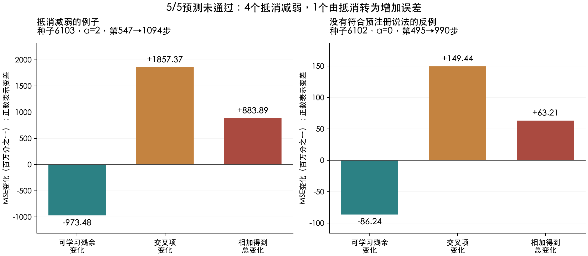

# D2 第五轮：学得更好，为什么总误差反而增加？

## 结论：找到了这5个例子的记账解释，但原来的5/5预测失败

上一轮留下5个难解释的例子：标签没有噪声，目标也能被模型表示，训练误差继续下降，总体误差却上升。

这轮把误差拆开后发现：**5例中，训练样本能约束的部分本身都在改善；但它与样本看不见的部分之间，交叉项增加得更多，最后总误差仍上升。**

预注册说得更窄：“5个都是原先为负的抵消变弱，前后仍在抵消。”结果只符合4个；另1个从互相抵消跨到了增加误差，必须记为反例。因此主预测是**4通过、1反驳、0未决**，没有改口包装成5/5。

这是对5个已选开发例子的风险分解，不是所有泛化恶化的普遍解释，也不是修复原任务的方法。

## 先理解：能表示答案，不代表训练样本能辨认答案

固定模型有129个输出参数，但这批训练样本只约束了部分方向。可能存在两套不同的参数，在所有训练输入上给出同样答案，在新输入上却不同。

| 本轮训练样本数 | 可被样本约束的参数方向数 | 训练样本看不见的方向数 |
|---:|---:|---:|
| 32 | 20 | 109 |
| 64 | 36 | 93 |

这些数来自本批固定特征、正负配对输入与参数坐标，不是“所有32样本只能提供20个方向”的规律。

从零开始训练时，模型沿着样本能约束的方向更新；看不见的目标部分无法由这些训练样本辨认。我们关心的是：前一部分逐渐学好后，为什么与后一部分组合起来反而更差？

## 把总误差拆成三笔账

| 部分 | 人话解释 | 本轮怎样变化 |
|---|---|---|
| 可学习部分的残余误差 | 在被样本约束的方向上，模型还没学到位的误差 | 5例都下降 |
| 不可辨认部分的误差 | 目标中在训练样本上看不出来的部分 | 保持不变 |
| 交叉项 | 两种误差在新输入上互相抵消，还是互相增加 | 5例都增加 |

这里的“可学习部分误差”也在**输入总体上**评价，不是直接把训练MSE改了个名字。

总误差 = 可学习残余 + 不可辨认误差 + 交叉项。交叉项为负表示抵消；负数变得接近0，意味着抵消减少，不意味着模型学到的东西变少。

一个纯示意的小例子：两种预测误差原来是+1和−2，合起来为−1，平方误差是1。把能学的+1消除后，剩下−2，平方误差反而变成4。局部误差改善，可能破坏原来碰巧存在的抵消。这个示意不是额外实验，也不是下面实测数值的替代。

## 一个真实例子：改善抵不过抵消损失

n=32、seed=6103、α=2，从第547步继续到1094步：

| 误差组成 | 早期 | 晚期 | 变化 |
|---|---:|---:|---:|
| 可学习残余 | 0.001383 | 0.000409 | -0.000973 |
| 不可辨认部分 | 0.030099 | 0.030099 | 0 |
| 交叉项 | -0.002415 | -0.000558 | +0.001857 |
| **总误差** | **0.029066** | **0.029950** | **+0.000884** |

可学习残余改善了约0.000973，但抵消减少带来约0.001857的增加，净结果是误差增加约0.000884。与此同时，训练MSE下降约0.000198。误差看起来矛盾的变化，现在能由同一笔加法复算出来。

## 为什么有1个没有通过

n=32、seed=6102、α=0，第495→990步，交叉项从-0.00007480变成+0.00007465。它不只是抵消变弱，而是越过0，变成增加误差。

这符合更宽泛的“交叉项增加超过可学习改善”描述，但不符合预注册的“两端仍为负”条件。更宽描述是本轮完整结果的归纳，不能拿它事后挽救原来的全5通过预测。

下表单位为百万分之一MSE；正号表示增加，负号表示减少。

| n/种子/α | 交叉项早→晚 | 可学习变化 | 交叉项变化 | 总变化 | 原预测 |
|---|---:|---:|---:|---:|---|
| 32/6101/0 | -345.58→-29.84 | -289.70 | +315.73 | +26.03 | 通过 |
| 32/6102/0 | -74.80→+74.65 | -86.24 | +149.44 | +63.21 | 反驳 |
| 32/6103/0 | -159.07→-33.89 | -25.46 | +125.18 | +99.72 | 通过 |
| 32/6103/2 | -2415.39→-558.02 | -973.48 | +1857.37 | +883.89 | 通过 |
| 64/6101/0 | -21.34→-5.95 | -6.61 | +15.39 | +8.78 | 通过 |

## 我们怎样避免“删掉一项就说修好了”

我们构造了另一套目标，只保留训练样本能约束的部分。它与原目标在训练输入上给出的标签相同，因此训练过程相同；但新输入上的正确答案不同。

换这个目标后，5个例子的总体误差都下降。这说明同一份训练信息和同一条训练轨迹，可以对应不同的总体表现。它是“训练样本无法分辨两套答案”的对照，**不是让原任务变好了**。原目标下的5个回升仍然保留。

分析沿用原来的参数坐标、特征中心、尺度和GD度量。我们既检查了训练矩阵的SVD，也利用正负配对与ReLU结构独立构造了高精度行空间；没有直接把旧特征值cutoff以下的方向都叫真实零空间。

## 下一步：增加真正的新信息，还是只增加样本计数？

下一轮候选保留这5个模型的特征和正确答案，比较两种“样本数加倍”：

- 把原训练集完整重复一遍：名义样本数增加，但平均损失和GD更新在解析上不变。
- 加入等量新抽取的正负配对输入，并给出同一目标生成的正确标签：增加了真正的新约束。

检验只有第二种增加，是否削弱原时间区间的回升及不可辨认部分的总体误差。后一项不保证随新增样本单调变小，也必须允许失败。追加数据同时改变训练速度，因此不能仅凭改善就归因于零空间缩小；步长稳定性规则也要提前冻结。重复数据不带来新信息是解析对照，不叫新发现；成对新输入的一对才是独立抽样单位，新抽样只用于重复性，不等于新任务泛化。下一轮尚未预注册或执行。

## 证据与检查

- 预注册commit：`251513bb1eca11f6cc3c3aeba063085933d92d72`，早于执行；固定分母为上一轮全部5个见证，完整54条件旧账保留于frozen_previous_ledger.json。
- rows.json保存所有有符号分量、前后风险、秩、分类及60位结果；decompositions/保存投影、两目标训练标签和未截断GD终点。
- 训练标签最大差4.4e-15；两标签直接GD在0、1、32、256、2000步核对，共25次，权重最大差2.1e-15。
- 冻结终点另用完整、未截断训练Gram动力学验证，最大风险误差5.4e-15；高精度结构投影和总体矩复核，成分最大差1e-16。
- 总误差与三项相加的最大差5.6e-17。数值细节见verification.json；恒等式正确不等于机制具有普遍性。
- 初始产物hash见manifest.json；报告/图/审计由仓库result_manifest.json另行固定。
- 单线程CPU约2.64秒，没有付费API、GPU、solver或网站发布。交接检查仍受当前worktree未初始化ArchitectureIQ子模块影响；未操作该子模块，D2原始输入逐文件hash已核对。回归测试与交接状态见result_manifest.json。

独立审计通过：使用另一组结构行基和70位计算确认分解，主预测仍为4通过、1反驳。详见independent_audit.json。
