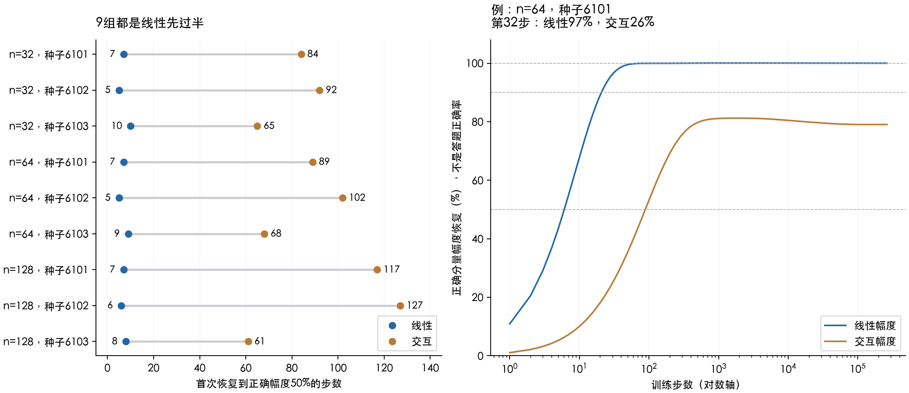

# D2 第六轮：模型偏好先学什么？

## 结论：这套模型先跟随样本均值，较快恢复线性，交互较慢

对当前固定特征、无噪声、线性与交互各占一半的目标，**9组已有条件全部先恢复线性分量的一半正确幅度**：线性需要5–10步，交互需要61–127步；中位数分别是7步和89步。预注册的9/9预测通过。

但“交互只是晚一点就能学好”没有得到支持：观察到262144步，8组从未达到90%交互幅度；另外1组短暂达到后又退回，而且这次越线受跨分量响应推动。纯交互响应自身9组都没有达到90%。

这是9个已观察开发条件，只有3个主种子、样本量嵌套，不是9种独立任务。结论不能扩大成所有模型都先学简单规律，也没有证明旧5个回升例子都由“先线性后交互”造成。

## “学出来多少”是怎样量的

本轮答案是y=(x₀+x₀x₁)/√2。x₀是线性部分，x₀x₁是交互部分，两者在输入总体上正交、均方相同。

我们测模型预测沿这两种正确规律的投影幅度，并除以正确答案对应的幅度。100%表示该方向幅度正确；50%表示幅度恢复一半。**这不是答题正确率，也不是总误差已经减少一半。** 模型可以同时产生其他错误成分。

| 优先发生的学习 | 证据 | 限制 |
|---|---|---|
| 跟随训练集的平均答案 | 常数参数第1步达到样本均值的60%，第3步约94% | 解析事实；训练均值未必等于真实总体均值，常数参数也不等于总体预测均值 |
| 较快恢复线性分量 | 9/9在5–10步过半，18–45步达到90% | 当前模型、数据和固定阈值下的测量 |
| 较慢恢复交互分量 | 9/9在61–127步过半 | 过半不等于充分或稳定学会 |
| 训练样本完全看不见的方向 | 零初始化下没有对应的训练更新 | 解析事实；继续重复相同信息不能辨认这些方向 |

## 看一个具体训练过程

固定n=64、seed=6101，两个规律在正确答案中同等重要：

| 步数 | 线性幅度恢复 | 交互幅度恢复 | 总体MSE |
|---:|---:|---:|---:|
| 1 | 10.9% | 1.1% | 0.88765 |
| 8 | 59.7% | 8.2% | 0.51137 |
| 32 | 97.0% | 26.2% | 0.29234 |
| 128 | 100.0% | 59.4% | 0.11978 |
| 512 | 100.0% | 79.9% | 0.06525 |
| 2048 | 100.0% | 81.2% | 0.06595 |

第32步，线性方向已经约97%，交互只有约26%。所以在这个例子中，“先线性、后交互”有直接数值证据，而不是从总loss曲线猜出来的。

## 为什么模型会这样学

模型没有一个写着“先学简单规律”的开关。梯度下降更快地修正那些对训练预测响应更强的方向。

在当前学习率下，第i个训练模态的残余系数每步乘以qᵢ=1−0.6λᵢ。λᵢ越大，相对恢复越快；λᵢ为0则不学。**不是所有方向统一乘0.9，每个方向都有自己的速度。** 绝对变化还取决于答案在这个方向上有多少分量。

这批数据中，线性标签主要对应较快的模态，交互标签更多对应较慢模态。已保存的训练能量加权系数半衰期，线性在3.4–7.3步，交互在25.5–82.4步；9组排序一致。这是在训练坐标中的速度描述，不等于总体误差下降速度。

“偏好”由特征表示、训练输入、归一化和优化器共同决定，不能说线性规律在所有参数化下天然先学。样本均值尤其说明：模型先跟随的东西，未必是正确的总体规律。

## 会不会只是交叉泄漏，让线性看起来学得快？

我们把同一混合训练过程拆成“纯线性标签驱动的响应”和“纯交互标签驱动的响应”。它们相加后等于混合轨迹，这是GD对标签的线性性质。

结果：只看各自的正确方向，9组依然都是纯线性响应先过50%。因此，本轮的过半先后并非仅由交叉泄漏造成。但泄漏会影响具体时间，不能忽略。

必须保留的例外是n128、seed6103：混合交互幅度在第449步短暂超过90%，之后退回。纯交互响应自身的最高幅度约89.90%，混合响应最高约90.09%。这次90%越线受跨分量影响，不能称为交互规律稳定学会。

## 后学到的东西，为什么不一定改善泛化

在上述n64、seed6101例子中，从512步继续到2048步：交互幅度还从约80%改善到81%，训练MSE也下降，但总体MSE开始增加。

| 总体误差组成 | 第512步 | 第2048步 | 变化 |
|---|---:|---:|---:|
| 线性幅度不匹配 | 0.000000 | 0.000000 | -0.000000 |
| 交互幅度不匹配 | 0.020288 | 0.017603 | -0.002685 |
| 目标两分量之外的预测成分 | 0.044963 | 0.048348 | +0.003385 |
| 总MSE | 0.065252 | 0.065951 | +0.000700 |

这说明：后期仍可能学到有用信号，但目标以外的预测成分增加得更多。这里没有标签噪声，不能把这些成分直接叫成“记住噪声”。这也不是上一轮可学习/零空间分解的同一组分项，不能把两套数值逐项混用。

## 全部9组结果与未达标情况

“未到”指整个0–262144步窗口没有达到；不是运行缺失。

| n/种子 | 线性50% | 交互50% | 线性90% | 交互90% |
|---|---:|---:|---:|---|
| 32/6101 | 7 | 84 | 24 | 未到 |
| 32/6102 | 5 | 92 | 41 | 未到 |
| 32/6103 | 10 | 65 | 45 | 未到 |
| 64/6101 | 7 | 89 | 21 | 未到 |
| 64/6102 | 5 | 102 | 18 | 未到 |
| 64/6103 | 9 | 68 | 41 | 未到 |
| 128/6101 | 7 | 117 | 24 | 未到 |
| 128/6102 | 6 | 127 | 18 | 未到 |
| 128/6103 | 8 | 61 | 40 | 449，随后退回 |

恢复系数还可能轻微超过100%（超调），全部峰值、后续退回和纯响应阈值都保存在rows.json中。首次越线与稳定掌握分开报告。

## 下一步：改变快慢偏好，能否改变泛化回升？

用户已将研究重点转向学习偏好，原“重复旧样本与追加新样本”的候选延后。下一候选固定目标、特征和样本，只把训练可学习方向的不同更新速度抹平，与原GD比较，并匹配训练MSE进度，避免把单纯加速当作更好的学习顺序。

要检验的是“快慢顺序是否为回升的必要条件”，不是预设抹平后一定更好。相同模态速度也不保证两个语义分量在同一原始幅度阈值同时达标，因为最终可恢复幅度可能不同。训练MSE匹配需要保留最小可达训练误差，连续进度匹配与实际整数训练步必须分开。固定共同终点时，同速路径上的风险是一个可解析的二次式，这个恒等式只能作对照，不能叫新发现。下一轮尚未预注册或执行。

## 证据与核验

- 预注册commit：`0923526c10b948734ae543b4fe594812efe8691d`，早于本轮计算；共9个draw，每个0–262144步逐整数评价，不靠稀疏绘图网格找首次过线。
- profiles/保存4个纯响应、2个混合响应、特征值/速度、全部有符号模态读出、训练能量和总体投影矩；rows.json保存全部阈值、缺失和退回。
- milestones.json保存固定检查步、阈值前后步和旧风险端点的分解。学习时间规则没有按结果调整。
- 9组×7步对两种纯标签做原坐标直接GD核对，响应最大差1.1e-14；未截断完整Gram对所有milestones核对，响应最大差1.5e-12。
- 恒等式、样本常数响应、原alpha1无噪声风险均复核。manifest.json固定初始产物，后补报告/图/审计由仓库result_manifest.json固定。
- 单线程CPU计算约5.89秒；没有模型API、GPU或网站发布。交接检查仍受当前worktree未初始化ArchitectureIQ子模块影响，该子模块未操作；D2原始输入逐文件hash已校验。测试状态见result_manifest.json。

独立审计通过，具体复核见independent_audit.json。
