# SAI 图解：衡量科学家的直觉

2026-10-29。本文是 [SAI 定义](SAI_definition.md) 的图解版，不新增主张；各处出处（用户原意、已有协议、定义中提出的操作化）以定义全文为准。标“示意”的图只说明概念，图中数字不是实测。图由 [`illustrated/build_figs.py`](illustrated/build_figs.py) 生成。

> **核心想法**（用户原意）：衡量科学家的直觉。等价算力是目前唯一定量的判据；更多的研究对象是知识怎样产生、知识在什么范围内成立。

五句话：

- 衡量科学家的直觉：这份直觉值多少算力，知识在哪里成立。
- 三把尺：错得少、花得少、管得宽。
- 知识是看到的，定律是量出来的，科学是推出来的。
- 知道自己哪里不灵，才值得信。
- 从“凭直觉挑、跑了才知道”，到“查了、算了就知道”。

## 0. 核心：衡量科学家的直觉

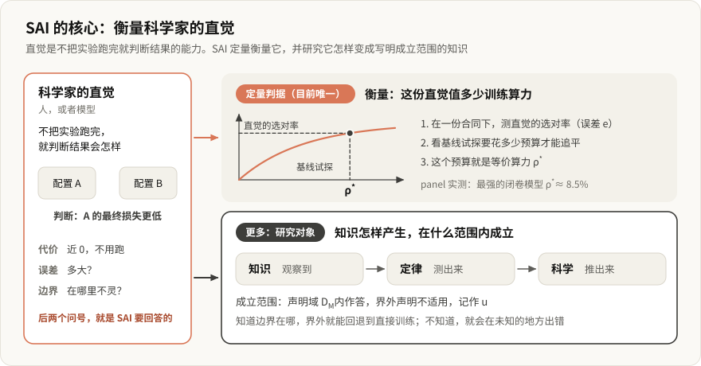

**直觉**指科学家（人或模型）不把实验跑完就判断结果的能力，例如看一眼两个训练配置，判断哪个最终损失更低。它几乎不花代价，难处在两个问题：判断错得多不多，在哪里会不灵。

- **衡量**回答第一个问题。在一份合同下测直觉的选对率，再看基线试探要花多少预算才能追平它，这个预算就是等价算力 ρ\*（第 3.4 节）。它是目前唯一定量的判据。
- **研究**回答第二个问题，也是 SAI 的大部分工作：直觉怎样变成写明成立范围的知识。三层（第 4 节）说边界是怎么知道的，声明域 D<sub>M</sub> 和不适用测度 u（第 3 节）说知识在哪里成立。

## 1. 全景

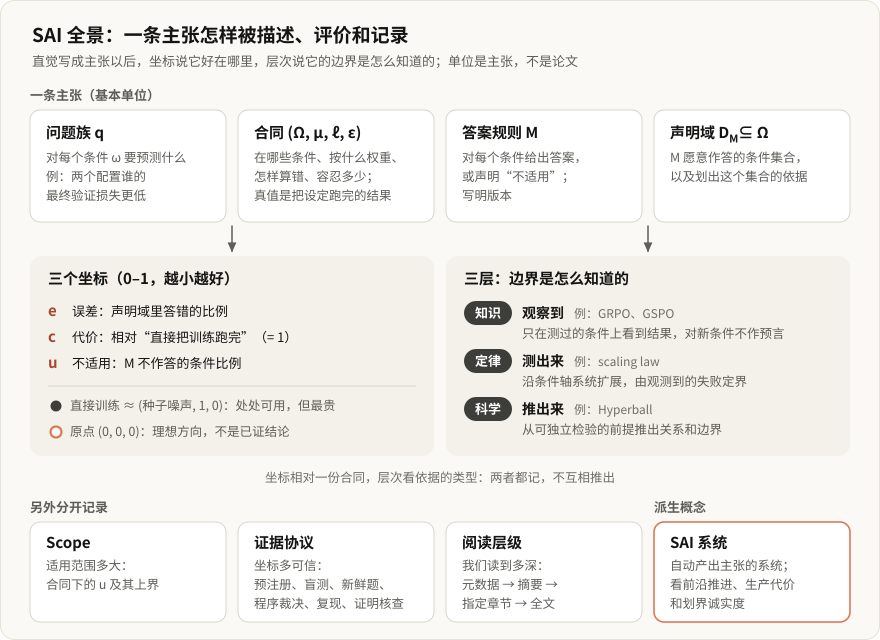

直觉写成主张以后，用两样东西描述：三个坐标说它好在哪里，层次说它的边界是怎么知道的。两者都记，不互相推出：坐标相对一份合同，层次看依据的类型。另有三项分开记录：Scope、证据协议和阅读层级。“SAI 系统”是派生概念，指自动产出主张的系统。

## 2. 基本单位：主张

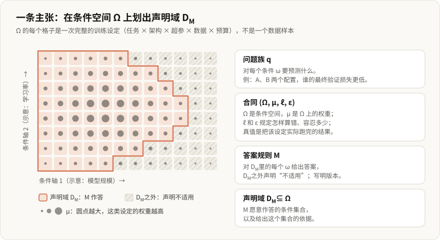

分类和计量的单位是一条主张，不是论文、作者或系统。一篇论文可以同时含方法、观察、经验关系和推导；它的主标签只是组织方式，不代表价值高低。一条主张写成四元组：

| 成分 | 含义 |
|---|---|
| 问题族 q | 对每个条件 ω 要预测什么 |
| 合同 (Ω, μ, ℓ, ε) | Ω 是条件空间，μ 是条件上的权重，ℓ 和 ε 是损失和容忍度 |
| 答案规则 M | 对每个条件作答，或声明“不适用”，并写明版本 |
| 声明域 D<sub>M</sub> ⊆ Ω | M 愿意作答的条件集合，以及划出这个集合的依据 |

Ω 的一个元素是一次完整的训练或评测设定，不是一个数据样本。μ 可以是实际部署分布，也可以是预先定义的研究设计，它不代表“整个世界”。真值是把该设定实际跑完的结果。

方法类论文（如 GRPO）同样适用：方法本身不是主张，“在设定 S 下使用该方法会得到结果 R”才是。

## 3. 三个坐标：好在哪里

三个坐标都在 0 到 1 之间，都越小越好：

- **误差 e**：声明域内答案超出 ε 的条件所占的比例，按 μ 计。
- **代价 c**：得到答案所花的计算、试探和信息，以“直接把训练跑完”为 1，在声明域上按 μ 平均。超过 1 的方法不如直接训练，截断在 1。
- **不适用测度 u**：M 不作答的条件的 μ 测度，u = μ(Ω \ D<sub>M</sub>)。

### 3.1 怎么算

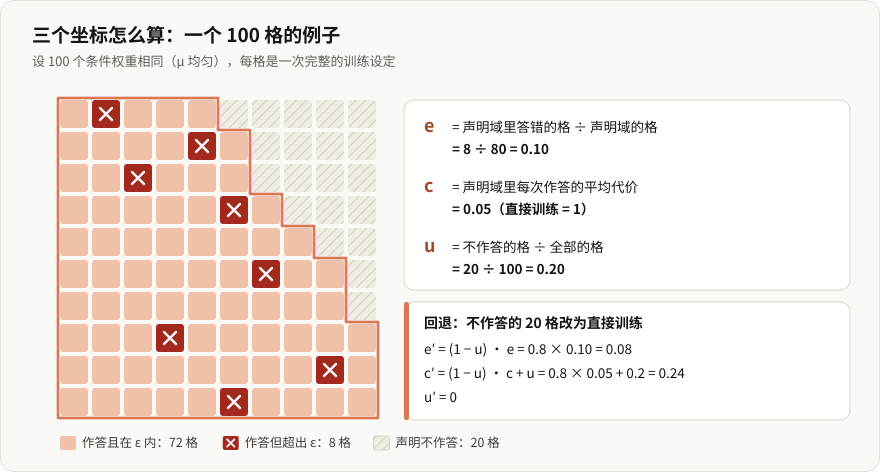

声明域内答错计入 e，声明不作答计入 u。所以越界声明（overclaim）表现为 e 升高，诚实划界表现为 u 升高。

### 3.2 三轴空间与两个参照点

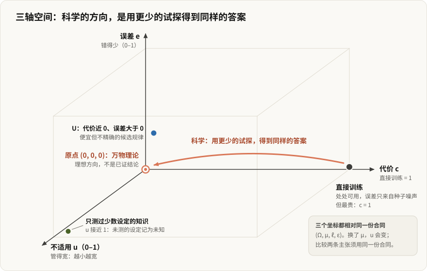

轴向沿用用户的手绘图：误差向上，代价向右，不适用测度朝向读者。

- **直接训练**在 (种子噪声, 1, 0)：处处可用，但最贵。它的误差不是严格的 0：期望型问题的单次运行带种子方差，这是真值本身的噪声底。
- **原点** (0, 0, 0)：零误差、零代价、处处适用，用户比作“万物理论”。它是理想方向，不是已证的数学等价。
- **科学的方向**（手绘图中的 Science 箭头）从直接训练指向原点：用越来越少的试探得到同样的答案。
- 手绘图里的 **U** 点代价近 0、误差大于 0，是便宜但不精确的候选规律。
- 只声明测过设定的**知识**，u 接近 1。

按这套坐标，直觉的代价近 0；它通常不声明边界、处处作答（u = 0），错误都落在 e 里。把直觉写成主张、划出声明域，就是把一部分 e 换成 u。

### 3.3 知道边界的价值

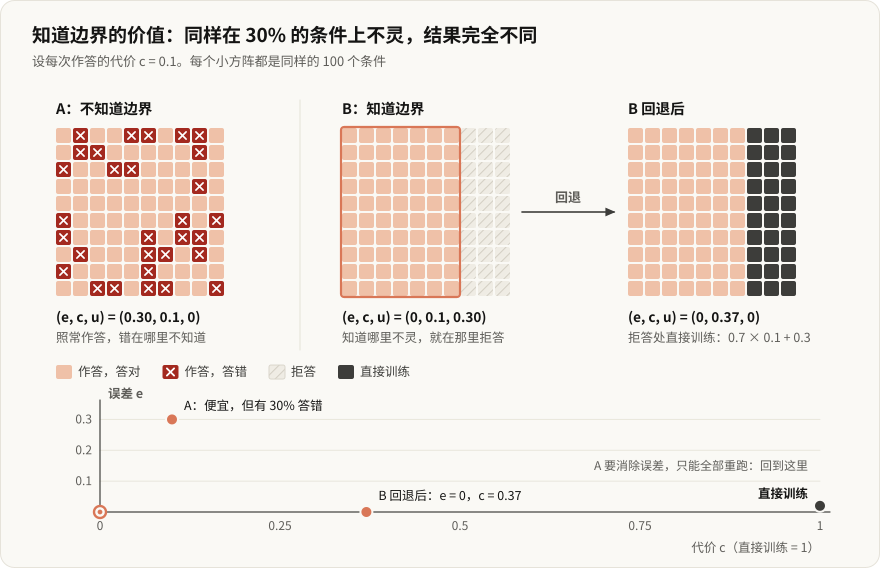

主张如果知道自己在哪里不适用，那部分可以回退到直接训练。组合方法的坐标为

```
e' = (1 − u)·e,   c' = (1 − u)·c + u,   u' = 0
```

也就是说，u 可以按单价 1 换成代价。不知道边界的主张做不到：它在未知的位置出错，使用者挑不出该回退的条件，要消除误差只能全部重跑。这是第 4 节用“怎样知道边界”分层的理由。

### 3.4 衡量直觉：等价算力

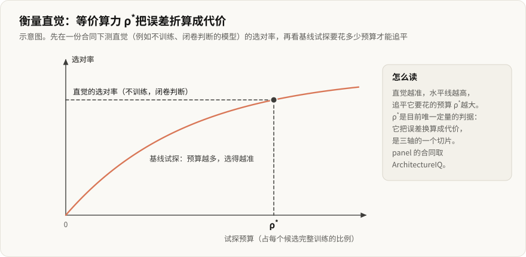

等价算力 ρ\* 是三轴的一个切片：先测一个直觉（例如不训练、闭卷判断的模型）在 ArchitectureIQ 合同下的误差，再问基线试探要花多少代价才能达到同样的误差，这个代价就是 ρ\*。它把误差折算成代价，是目前唯一定量的判据。

panel 的实测：最强的闭卷模型选对 77.6%，基线试探要花每个候选训练预算的 8.5% 才能追平；用 10% 的预算试探，选对率是 79.4%，超过全部闭卷模型。

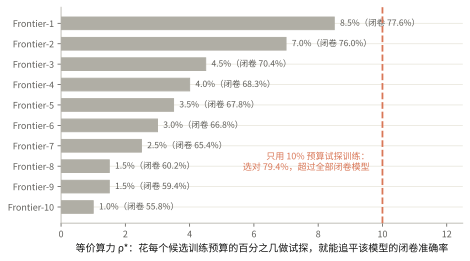

ArchitectureIQ 的条件空间很窄（第 8 节），这些数字只在它的合同下成立。

### 3.5 有限实验只给上界

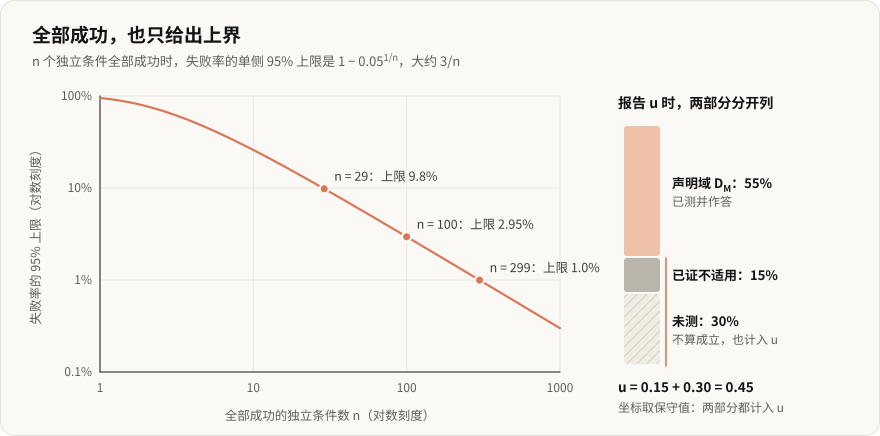

| 全部成功的独立条件数 n | 失败率的单侧 95% 上限 |
|---:|---:|
| 10 | 25.9% |
| 29 | 9.81% |
| 100 | 2.95% |
| 299 | 0.997% |
| 1000 | 0.299% |

- 三个坐标都相对合同。换 μ，u 会变；比较两条主张必须用同一份合同，否则坐标不可比。
- 有限实验只给估计和上界。未测的条件记为未知，不算成立。报告 u 时，“已证不适用”与“未测”分开列出，坐标取保守值，两者都计入 u。
- u = 0 表示在 μ 下几乎处处适用，不等于逐点无例外。
- 相关样本（同数据的重复 seed、重复 prompt）不是独立条件；用测试结果反复挑模型或阈值后，简单的区间解释不再成立。

## 4. 三层：边界是怎么知道的

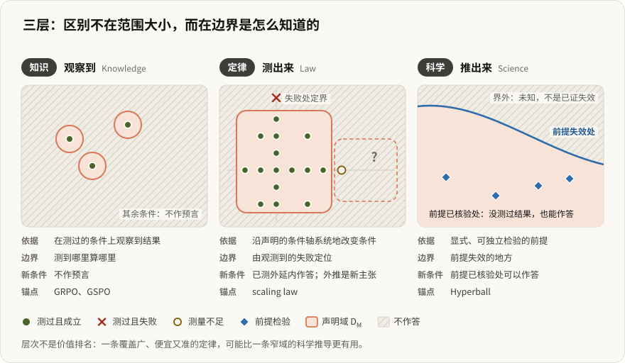

三层的区别不在范围大小，而在边界是观察到的、系统扩展测到的，还是从原理推出的。锚点由用户指定。

| 层 | 依据 | 边界从哪来 | 对新条件 | 锚点 |
|---|---|---|---|---|
| 知识 | 在测过的条件上观察到结果 | 测到哪里算哪里 | 不作预言 | GRPO、GSPO |
| 定律 | 沿声明的条件轴系统地改变条件 | 观测到的失败 | 已测外延内作答；越界外推是新的、证据更弱的主张 | scaling law |
| 科学 | 显式、可独立检验的前提 | 前提失效的地方 | 前提已核验处可以作答，即使结果没测过 | Hyperball |

层次不是价值排名：一条覆盖广、便宜又准的定律，可能比一条窄域的科学推导更有用。

### 4.1 定律：沿条件轴扩展

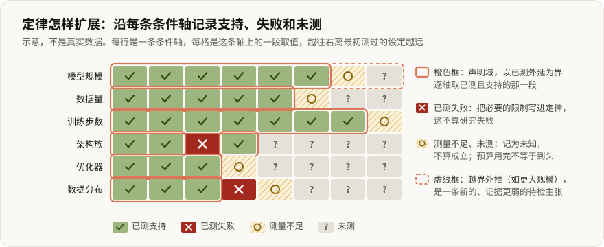

沿声明的条件轴系统地改变条件，逐轴记录“已测且支持、已测且失败、测量不足、未测”。边界由观测到的失败定位，预算用完不等于到头。发现必要的限制，就把它写进定律，这不算研究失败。定律通常用少量参数概括一族结果，所以在声明域内代价很低；拟合本身的生产代价另记（第 6 节）。

### 4.2 科学：前提、推导与内界

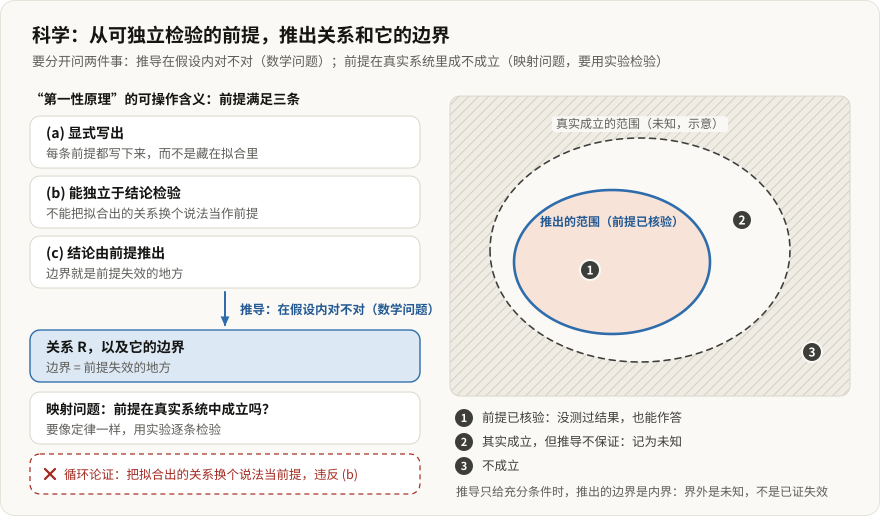

“第一性原理”的可操作含义是前提满足三条：显式写出；可以独立于所预测的关系去检验；结论由前提推出，边界就是前提失效的地方。单条明确的条件推导即可，不要求推出多条定律、引入新坐标或通过盲测。

要分开问两件事：推导在假设内是否正确，是数学问题；前提在真实系统中是否成立，是映射问题，要像定律一样用实验检验。推导只给出充分条件时，推出的边界是内界：界外是未知，不是已证失效。

例：Hyperball 按主贡献是科学。它的尺度不变性代数在假设内成立；真实网络只近似满足这些假设，批评文给出了竞争解释。

### 4.3 晋升、降级，以及不构成依据的东西

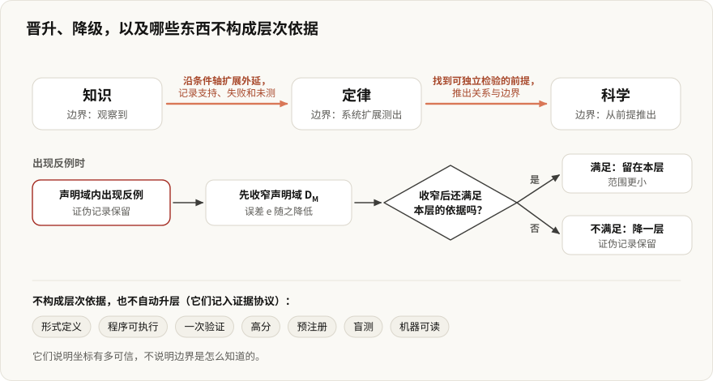

- 知识 → 定律：沿条件轴扩展外延，记录支持、失败和未测。
- 定律 → 科学：找到可独立检验的前提，推出关系与边界。
- 降级：声明域内出现反例时，先收窄 D<sub>M</sub>，降低 e；收窄后不再满足本层依据，就降一层。证伪记录保留。

形式定义、程序可执行、一次验证、高分、预注册、盲测、机器可读，都不自动构成科学，也不自动升层。它们属于证据协议。

## 5. 分开记录的四件事

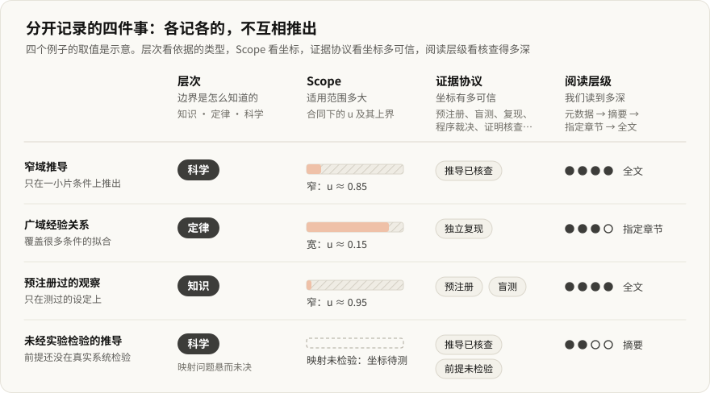

| 维度 | 回答的问题 | 例子 |
|---|---|---|
| 层次 | 边界是怎么知道的 | 知识、定律、科学 |
| Scope | 适用范围多大 | 合同下的 u 及其上界 |
| 证据协议 | 坐标有多可信 | 预注册、盲测、新鲜题、程序裁决、独立复现、证明核查 |
| 阅读层级 | 我们读到了多深 | 研究库的 `review_level`：元数据、摘要、指定章节、全文 |

窄域推导可以是科学，广域经验关系仍是定律。一条预注册过的观察仍是知识；一条未经实验检验的推导仍是科学，只是映射问题悬而未决。

## 6. SAI 系统

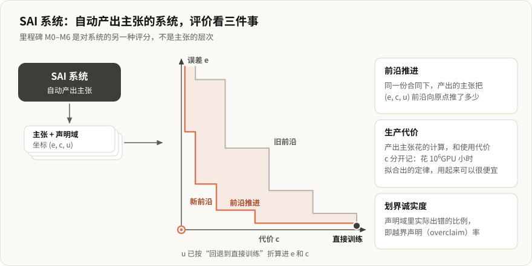

SAI 系统指自动产出主张的系统，是派生概念。评价它看三件事：

- **前沿推进**：在一份固定合同下，它产出的主张把 (e, c, u) 前沿向原点推了多少。
- **生产代价**：产出这些主张花的计算，与使用代价 c 分开记。一条拟合花了 10<sup>6</sup> GPU 小时的定律，使用起来可以很便宜。
- **划界诚实度**：它声明的 D<sub>M</sub> 里实际出错的比例，即越界声明率。

里程碑 M0–M6 是对系统的另一种评分，不是主张的层次。

## 7. 意义与前景

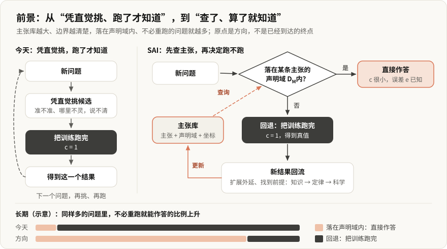

- **省算力**：能提前判断的实验，不必真的跑一遍。
- **可信**：主张写明在哪里不成立，用的人知道什么时候该自己去验证。
- **可累积**：以单条主张为单位记录，可以被证伪，也可以升层或降层，不必整篇论文一起推翻。

长期的方向，是让 AI 研发从“凭直觉挑、跑了才知道”，变成“查了、算了就知道”：直觉有了价码，知识写明了成立范围；落在某条主张声明域内的问题可以不跑，落在外面的回退到训练，新结果再回流成知识、定律和科学。原点是方向，不是可以宣称已经到达的终点。目前只有 ArchitectureIQ 接近共同的条件基准，而它覆盖的条件还很窄。

## 8. 未决问题

1. **Ω 和 μ 没有天然的选择。** 不存在“所有 AI 系统”上的典范测度，所以 u 只在共同合同下可比。跨主张比较需要一份公开的条件基准；目前只有 ArchitectureIQ 接近这一角色，它的 Ω 很窄。
2. **真值有噪声底。** 直接训练的 e 不为 0，期望型问题需要重复种子；种子方差小于某个阈值的问题才适合判对错。
3. **代价的口径要统一。** c 应同时计算力和信息（试探次数、需要看的训练前缀），统一用相对直接训练的比例。
4. **“第一性原理”是相对的。** 前提必须能脱离结论单独检验，这条是最低防线，挡不住所有循环论证，判定仍要逐条审。
5. **三轴不决定层次。** 同一坐标的两条主张可以有不同依据；两者都记，不互相推出。
6. **层次不是价值排名。**
7. **与冻结稿的差异。** 冻结稿把机器可读、程序裁决、预注册盲测写进层次准入；现定义把它们移到证据协议。

## 9. 记录模板

每条主张至少记录：

- 主张原文与来源版本（论文、页码、版本日期）
- 问题族 q 与答案规则 M（含版本）
- 合同：Ω 的轴与取值范围、μ、ℓ、ε、随机性的判定方式
- 声明域 D<sub>M</sub> 及依据类型：观察、系统扩展或推导
- 坐标：e、c、u 的点估计与上界；u 拆为已证不适用与未测两部分
- 逐轴记录：已测支持、已测失败、测量不足、未测
- 科学类另记：前提清单、每条前提的独立检验状态、推导核查状态、充分还是必要
- 证据协议与阅读层级
- 已知反例与证伪记录

## 重画这些图

```bash
python3 illustrated/build_figs.py
```

每张图自带浅色底，在亮色和暗色页面上都能读；配色按色觉障碍校验过，失败、支持、测量不足、未测还用 ×、✓、○、? 区分，不只靠颜色。
