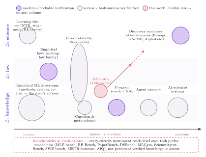
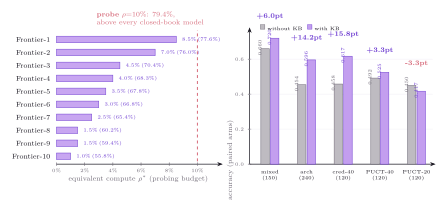

# The SAI Taxonomy

A machine-checkable classification system for machine-learning research: every work, claim, or system is placed by **what it knows** (epistemic level) and **who produces it** (human, human+machine, machine).

**SAI is a deliberately double name** — the *object* (a body of knowledge about ML with machine-checkable applicability boundaries) and the *system* (an agent that produces such knowledge). The ladder assigns the grade; the loop earns it.

## Read in this order

| Page | Content |
|---|---|
| [overview.md](overview.md) | The dual definition, why a new noun, and the two senses as one system |
| [ladder.md](ladder.md) | The three-level hierarchy L1 knowledge / L2 law / L3 science, with admission, promotion, and demotion gates — and concrete verified works at each level |
| [loop.md](loop.md) | The full state space: experimental universe, state tuple, five operators, four discipline invariants |
| [metrics.md](metrics.md) | How to measure: equivalent compute, compression ratio, SAI Index |
| [milestones.md](milestones.md) | Roadmap M0–M6 and the heroes table (existing systems mapped onto the ladder) |
| [families.md](families.md) | The ten research families, classified by level and producer |
| [results.md](results.md) | Prototype evidence: KB loop, fuzzy-direction campaign, negative results, RL survey audit |
| [reading.md](reading.md) | Where to start in the literature, by role |

## Core figures

| Epistemic hierarchy + minimal loop | Full state space |
|---|---|
|  |  |

| Positioning map | Prototype measurements |
|---|---|
|  |  |

## The taxonomy in one paragraph

Machine learning accumulates thousands of empirical results a year but has no shared account of what has actually been learned. This taxonomy fixes three epistemic levels with **machine-checkable gates**: a *knowledge claim* (L1) is a conditional, code-verified observation with an explicit applicability region; a *law* (L2) is a parametric quantitative relation with fit/test separation, held-out error tolerance, and a counterexample budget; a *scientific model* (L3) derives whole clusters of laws as limiting cases, passes blind pre-registered predictions, and survives competition against rival explanations. Promotion is earned by passing gates; demotion is automatic when evidence fails. A system climbs the ladder through five operators — Solve, Discover, Verify, Synthesize, Propose — over a state that keeps a knowledge base, an append-only experiment log, policies, and a budget ledger.

## Status

Draft taxonomy accompanying a manuscript in preparation. Numbers in [results.md](results.md) come from the prototype campaigns in this repository (`evidence/`, `science_program_v2/`, `docs/directions/`); model identities are anonymized in the public figures. Citation details for all referenced works live in the companion [survey](../survey/).
