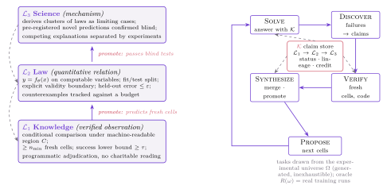

# The Epistemic Ladder

Three levels, each defined by **admission gates a machine can check**. Nothing enters a level by reputation, and nothing stays by seniority: demotion is automatic when evidence fails.

## L1 — Knowledge (verified observation)

A **claim** is a tuple (φ, C, E, σ, ℓ): statement φ, applicability region C, evidence E, status σ, level ℓ. A claim is L1-admitted iff:

1. φ is a conditional comparison over a machine-readable region C;
2. E contains ≥ n_min cells in C, created after registration, with code-verified adjudication and success lower bound ≥ τ;
3. the lineage is recorded (which cells, which runs, which adjudications).

Typical L1 statements: "under optimizer O, budget B, regime C, schedule X beats Y by δ." The gate is deliberately cheap — the point is that **most published empirical claims never clear it** (no pre-registration, no fresh-cell replication, no explicit region).

**Verified exemplars (genuine L1 by the gate discipline):** the Chinchilla token–parameter ratio as originally scoped; "weight decay ≈ spectral-norm control" within its tested regime; flash-attention IO-complexity analyses; μTransfer's width-transfer rule within its tested envelope.

## L2 — Law (quantitative relation)

A claim is promoted to law iff it is a parametric relation y = f_θ(x) on computable variables, and:

1. x, y computable for any cell; f_θ from a declared parametric family;
2. train/test split over cells; held-out error ≤ ε;
3. explicit validity boundary; counterexample log with budget b.

**Verified exemplars:** Kaplan et al. 2020 and Hoffmann et al. 2022 neural scaling laws (the field's canonical L2 family); data-constrained scaling (Muennighoff et al.); μP/μTransfer hyperparameter-transfer laws; parts of the grokking and double-descent phenomenology when fitted parametrically. The prototype's two candidates: *effective-time accounting* U = Σ_t η_t·ĉ_t (learning-rate-weighted compute) and *PUCT guidance scaling* U_c ∝ n/σ².

## L3 — Science (mechanism)

A model is promoted to science iff it is an explanatory structure (toy model, theory, or causal account) that:

1. derives a whole cluster of laws as limiting cases;
2. states novel pre-registered predictions that are confirmed blind;
3. survives competition: at least one rival explanation was pre-registered and separated by experiment.

**Verified exemplars (partial — each passes some, not all, gates):** NTK/lazy-training theory (derives wide-net limits); statistical-mechanics analyses of generalization; sparse-autoencoder feature accounts as mechanistic fragments; RL theory for tabular/linear regimes. The full three-gate bar has arguably never been cleared in ML — the ladder is honest about that.

## Gates are the point

| Gate | Direction | Test |
|---|---|---|
| Admission | → L1 | code-verified, replicated, region-tagged observation |
| Promotion | L1 → L2 | predicts fresh cells quantitatively |
| Promotion | L2 → L3 | passes blind pre-registered tests + competition |
| Demotion | any → lower | counterexample over budget; failed blind prediction; sealed-set violation |

The demotion rules are what make the levels a scientific instrument rather than a prestige ranking: a law that fails outside its stated boundary is *narrowed*, not excused; a model that fails blind is *demoted*, not patched invisibly. Refutations stay in the record (see discipline invariants in [loop.md](loop.md)).

## Where today's field sits

Audit of 213 canonical works ([survey](../survey/), audit table in [results.md](results.md)):

| Direction | L1 | L2 | L3 |
|---|---|---|---|
| Interpretability (57) | 39 | 6 | 12 |
| RL post-training (51) | 43 | 3 | 5 |
| Pre-training (105) | 86 | 13 | 6 |
| **Total** | **168** | **22** | **23** |

The field is almost all L1. The ladder's value is not the verdict — it is that the verdict is **reproducible by a machine**.
