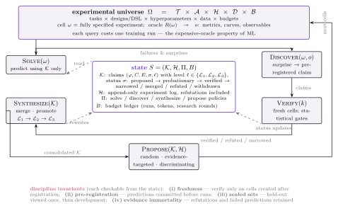

# The Research Loop: state space, operators, disciplines

## The experimental universe

Ω = T × A × H × D × B — tasks × designs/DSL × hyperparameters × data × budgets. A **cell** ω is a fully specified experiment; the oracle R(ω) → o is a **real training run** returning metrics, curves, and observables. Two properties shape everything:

- **Inexhaustible**: the universe is generated, not fixed — fresh cells are always available, which is what makes pre-registration and freshness checkable at all.
- **Expensive oracle**: each query costs a training run. Random exploration is not a strategy; the Propose operator is where research taste enters.

## The state

S = (K, H, Π, B):

- **K** — the claim store: claims (φ, C, E, σ, ℓ) with level ℓ ∈ {L1, L2, L3} and status σ: proposed → probationary → verified → narrowed / merged / refuted / withdrawn.
- **H** — append-only experiment log. Refutations included. Nothing is ever deleted.
- **Π** — the policies: solve / discover / synthesize / propose.
- **B** — budget ledger: runs, tokens, research rounds.

## The five operators

| Operator | Signature | Job |
|---|---|---|
| **Solve** | (ω) → answer | predict the outcome of a cell using K only — closed-book for the machine |
| **Discover** | (ω, o) → claims | turn surprises and failures into pre-registered claims |
| **Verify** | (k) → status | test claims on fresh cells under statistical gates |
| **Synthesize** | (K) → K′ | merge, promote L1→L2→L3, narrow, or refute |
| **Propose** | (K, H) → cells | pick the next cells: random · evidence-targeted · discriminating |

The minimal loop needs no Synthesize and runs Solve–Discover–Verify–Propose; the full loop adds consolidation. Solve is the entry gate because it makes knowledge **load-bearing**: if the KB is wrong, Solve fails, and the failure feeds Discover.

## The four discipline invariants

Each checkable from the state, by a machine:

1. **Freshness** — verify only on cells created after the claim was registered.
2. **Pre-registration** — predictions committed before runs.
3. **Sealed sets** — a held-out set is viewed once, then joins development.
4. **Evidence immortality** — refutations and failed predictions are retained forever.

These are the difference between a research loop and a curve-fitting loop. All four are enforceable programmatically — that is the entire point of the design.

## Instantiation in this repository

The KB runtime (`src/kb/`) is the claim store K: claims, KB items, promotion/demotion history. The directed-science campaigns (`science_program_v2/`, `docs/directions/`) are Discover+Verify loops with pre-registration artifacts in `evidence/`. The fuzzy-direction campaign's selector instrumentation is the Propose policy under test (selection-sensitivity results in [results.md](results.md)).
